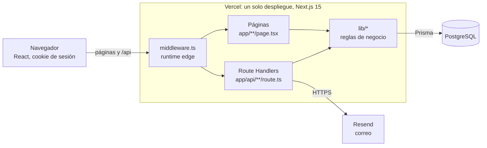

# Arquitectura de COGIT

Guía para quien se incorpora al desarrollo. Explica cómo está armado el sistema, dónde vive cada pieza, cómo se configura y cómo llega a producción. Está escrita a partir del código de la rama `dev`; lo que no se puede comprobar desde el repositorio (paneles de Vercel y de la base de datos) se marca como **por verificar**.

## 1. Visión general

COGIT es un **monolito full-stack** en Next.js. Un solo proyecto contiene la interfaz, la API y el acceso a la base de datos. No hay servicios separados ni colas.



| Capa | Tecnología | Dónde |
|---|---|---|
| Interfaz | React 18, Next.js 15 (App Router), Tailwind 3, Radix/shadcn, Framer Motion | `app/`, `components/` |
| API | Route Handlers de Next.js | `app/api/` |
| Lógica de negocio | TypeScript puro, con pruebas | `lib/` |
| Datos | PostgreSQL con Prisma 6 | `prisma/`, `lib/prisma.ts` |
| Sesión | Cookie firmada HMAC-SHA256 (Web Crypto) | `lib/session.ts`, `middleware.ts` |
| Correo | Resend, vía API HTTP | `lib/correo.ts` |
| Pruebas | Vitest | `**/*.test.ts` |
| Gestor de paquetes | pnpm 10, Node 20 en CI | `pnpm-lock.yaml` |

## 2. Estructura del repositorio

```
app/                  Rutas (App Router) y API
  page.tsx            Landing pública
  login, registro, recuperar-password, restablecer-password, terminos
  misiones/           Catálogo y actividades: [seccion]/[nivel]/actividad/[actividad]
  minijuegos/         sudoku, nonogramas, robot-programmer
  ranking, comunidad, perfil
  admin/              Panel: usuarios, contenido, estadísticas (solo rol admin)
  api/                Backend (ver sección 5)
components/           UI: ui/ (shadcn), misiones/nivel1..6, sudoku, nonogram, robot-programmer, admin, brand, landing
lib/                  Lógica y utilidades (ver sección 6)
  generated/prisma    Cliente Prisma generado (salida configurada en schema.prisma)
prisma/               schema.prisma y migrations/
scripts/              precargar-pruebas.mjs
docs/                 Requisitos, estado, verificación y esta guía
middleware.ts         Control de acceso por ruta
next.config.mjs       Cabeceras de seguridad y opciones de build
.github/workflows/    CI y etiquetado de issues
```

Alias de importación: `@/` apunta a la raíz del proyecto (`tsconfig.json` y `vitest.config.ts`).

## 3. Frontend

- **App Router.** Casi todas las pantallas son componentes de cliente (`"use client"`) que llaman a `/api/...` con `fetch`. No hay una capa de estado global como Redux.
- **Contextos de React** (en `app/layout.tsx`):
  - `ThemeProvider` (`next-themes`): tema oscuro por defecto, con claro.
  - `NeuronasProvider` (`components/misiones/neuronas-context.tsx`): estado de las neuronas de la cuenta. Ver sección 7.
- **Misiones.** La página `app/misiones/[seccion]/[nivel]/actividad/[actividad]/page.tsx` es un despachador: cada actividad del catálogo trae una clave `juego` y la página la mapea a un componente (`JUEGOS_UI`). Agregar una actividad con un juego existente no exige tocar la página. Los componentes viven en `components/misiones/nivel1`…`nivel6`.
- **Minijuegos.** Sudoku, nonogramas y Robot Programmer son páginas completas en `app/minijuegos/*`, con su lógica en `lib/` (`sudoku.ts`, `nonogram.ts`, `robot-programmer.ts`).
- **Estilo.** Identidad y tokens en `DESIGN.md`; propósito y usuarios en `PRODUCT.md`. Colores como variables CSS en `styles/globals.css` y `app/globals.css`, con modo claro y oscuro.
- **Guardado de partida.** `lib/use-autoguardado.ts` guarda el estado en curso poco después de cada cambio (REQ-006) y `lib/estado-partida.ts` valida lo que se retoma.

## 4. Backend

No hay servidor aparte: cada archivo `app/api/**/route.ts` es una función serverless en Vercel. Patrón común de una ruta:

1. Leer la sesión con `getSession(req)` (`lib/auth.ts`). Sin sesión responde 401.
2. Validar el cuerpo (a mano o con Zod).
3. Usar Prisma (`lib/prisma.ts`) y las reglas de `lib/`.
4. Devolver JSON con el código HTTP adecuado.

Dos reglas que se repiten y conviene mantener:

- **El usuario sale siempre de la sesión**, nunca del cuerpo ni de la URL. Solo un administrador puede consultar el progreso de otra persona.
- **El servidor decide lo que importa.** Los puntos de los minijuegos los fija `lib/minijuegos-puntos.ts`; el cliente no los envía. (Los puntos de las misiones sí los envía el cliente: está documentado como riesgo pendiente en `docs/verificacion-rnf.md`.)

## 5. Mapa de la API

| Ruta | Métodos | Qué hace | Acceso |
|---|---|---|---|
| `/api/usuario` | POST | Registro. Exige aceptar los términos; el rol siempre es `estudiante`. | Público |
| `/api/usuario/login` | POST | Inicia sesión y coloca la cookie. Migra contraseñas antiguas a scrypt. | Público |
| `/api/usuario/logout` | POST | Borra la cookie. | Público |
| `/api/usuario/me` | GET, PATCH | Datos de la cuenta; PATCH cambia, por ejemplo, la visibilidad en el ranking. | Sesión |
| `/api/usuario/neuronas` | GET, POST | Lee las neuronas (con la recarga aplicada) o descuenta una. | Sesión |
| `/api/usuario/cambiar-password` | POST | Cambia la contraseña. | Sesión |
| `/api/usuario/recuperar` | POST | Envía el enlace de recuperación por correo. Misma respuesta exista o no la cuenta. | Público |
| `/api/usuario/restablecer` | POST | Usa el enlace de un solo uso para fijar una contraseña nueva. | Público (con token) |
| `/api/progreso` | GET, POST | Guarda y lee resultados completados. | Sesión |
| `/api/progreso/parcial` | GET, PUT, DELETE | Actividad a medias para retomarla. | Sesión |
| `/api/misiones/catalogo` | GET | Niveles y actividades de las misiones. | Sesión |
| `/api/ranking` | GET | Ranking semanal o global, solo con alias. | Público |
| `/api/admin/usuarios` | GET | Lista de usuarios. | Admin |
| `/api/admin/usuarios/[id]` | PATCH | Cambia rol u otros datos de un usuario. | Admin |
| `/api/admin/contenido` | PUT | Edita un nivel y sus actividades. | Admin |

## 6. Módulos de `lib/` que sostienen el sistema

| Archivo | Responsabilidad |
|---|---|
| `session.ts` | Firma y lectura de la cookie `cogit_session`. Solo Web Crypto, para que corra también en el middleware (edge). |
| `auth.ts` | Reexporta `session.ts` y agrega hash scrypt, validación de usuario y correo. Solo Node: no importarlo desde el middleware. |
| `admin-guard.ts` | `requireAdmin`: vuelve a leer el rol en la base en vez de fiarse de la cookie. |
| `prisma.ts` | Un único `PrismaClient` por proceso. |
| `neuronas.ts` | Reglas de las neuronas: recarga y descuento. |
| `contenido.ts`, `contenido-schema.ts`, `misiones-catalogo.ts` | Catálogo de misiones: lectura de la base, esquema Zod y contenido inicial de reserva. |
| `guardar-resultado.ts`, `resultados-cuenta.ts`, `use-resultados.ts` | Guardado y lectura de resultados de minijuegos. |
| `minijuegos-puntos.ts` | Puntos fijos por nivel de minijuego. |
| `recuperacion.ts`, `correo.ts`, `terminos.ts` | Recuperación de contraseña, envío de correo y versión de términos. |
| `patrones.ts`, `generador-patrones.ts`, `algoritmos.ts`, `abstraccion.ts`, `descomposicion.ts` | Generadores y reglas de las actividades de cada nivel. |
| `sudoku.ts`, `nonogram*.ts`, `robot-programmer.ts` | Lógica de los minijuegos. |

## 7. Autenticación, sesión y roles

- **Login** con nombre de usuario y contraseña. El correo solo sirve para recuperar el acceso.
- **Contraseñas:** scrypt con sal (`scrypt$<sal>$<hash>`). Las cuentas antiguas en texto plano se cifran al iniciar sesión.
- **Sesión:** cookie `cogit_session`, `httpOnly`, `sameSite=lax`, `secure` en producción, vigencia de 7 días. Contiene `{uid, rol, exp}` firmado con HMAC-SHA256 y `SESSION_SECRET`. No hay sesiones guardadas en el servidor, por eso cambiar la contraseña no cierra las sesiones abiertas (hallazgo pendiente en `docs/verificacion-rnf.md`).
- **Roles:** enum `Rol` (`estudiante`, `admin`). Hay además la marca `modoPruebas` en `Usuario`: una cuenta que ve todo desbloqueado y no pierde neuronas, sin acceso al panel de administración.
- **`middleware.ts`** (runtime edge) protege las páginas:
  - Públicas: `/`, `/login`, `/registro`, `/recuperar-password`, `/restablecer-password`, `/terminos`, y `/api`, `/_next` y archivos estáticos.
  - `/admin` exige sesión con rol `admin`; si no, redirige.
  - El resto exige sesión; si no, redirige a `/login`.
  - **Las APIs no pasan por el middleware**: cada ruta valida su propia sesión. Una ruta nueva sin `getSession` queda abierta.
- `login/page.tsx` aún guarda `userId`, `userRol` y `usuario` en `localStorage`. Son datos de interfaz: la autorización real es la cookie.

## 8. Base de datos

PostgreSQL, modelada con Prisma (`prisma/schema.prisma`). El cliente se genera en `lib/generated/prisma` (`binaryTargets` incluye `rhel-openssl-3.0.x`, el binario que usa Vercel).

| Modelo | Para qué sirve |
|---|---|
| `Usuario` | Cuenta: alias, correo, hash, rol, `modoPruebas`, `visibleEnRanking`, aceptación de términos y **neuronas** (`neuronas`, `maxNeuronas`, `ultimaRecarga`). |
| `Progreso` | Resultado de una actividad completada. Único por `userId+seccion+nivel+actividad`. Guarda el mejor puntaje. |
| `ProgresoParcial` | Estado en curso (JSON) de una actividad, con un tope de tamaño. Se borra al completar o reiniciar. |
| `Nivel`, `Actividad` | Contenido de las misiones, editable desde el panel de administración. |
| `RecuperacionPassword` | Enlace de un solo uso: guarda el hash del token, vigencia de 60 min. |

Convenciones:

- **Progreso por clave, no por fila de contenido.** Editar o reordenar niveles no borra el progreso de los estudiantes.
- **Los minijuegos usan la misma tabla `Progreso`** con `seccion = "minijuegos"`, `nivel` = juego (`sudoku`, `nonogramas`, `robot`) y `actividad` = nivel dentro del juego.
- **El contenido tiene reserva.** Si la base no tiene niveles o el contenido no cumple el esquema Zod, `leerCatalogo()` devuelve `CATALOGO_INICIAL` en vez de romper la app.

### Migraciones

Están en `prisma/migrations/` y se aplican con `prisma migrate deploy` solo en **producción** (ver sección 10). Varias migraciones de contenido (`contenido_misiones`, `contenido_nivel2`…) insertan el catálogo; una prueba comprueba que la migración y `CATALOGO_INICIAL` no se desvíen.

## 9. Neuronas (las vidas)

Las neuronas son el único sistema de vidas de la plataforma.

- **Fuente de verdad: la base de datos** (`Usuario.neuronas`, `maxNeuronas`, `ultimaRecarga`). Máximo 5 por defecto.
- **Regla (`lib/neuronas.ts`):** un error descuenta una; se recupera una cada 30 minutos (`MINUTOS_RECARGA`). La recarga se calcula al consultar o descontar, no hay tarea programada. Nunca baja de 0. En `modoPruebas` no se descuenta.
- **Cliente:** `NeuronasProvider` lee `/api/usuario/neuronas`, muestra el cambio al instante y lo confirma contra el servidor; `useNeuronas()` lo expone a misiones y minijuegos, y `neuronas-indicator.tsx` lo muestra en la interfaz.
- **API:** `GET /api/usuario/neuronas` consulta; `POST` descuenta una.

Las vidas que aparecen *dentro* de un minijuego (por ejemplo, 3 por partida en sudoku o robot) son una regla local de esa partida. Ver el issue #88 para el estado de la unificación.

## 10. Despliegue y entornos

| Entorno | Rama / origen | Dónde corre |
|---|---|---|
| Local | tu máquina | `pnpm dev` en `http://localhost:3000` |
| Preview | cada PR y la rama `dev` | Vercel (despliegue de vista previa) |
| Producción | rama `main` | Vercel: https://cogit-nine.vercel.app |

- **Hosting:** Vercel, conectado al repositorio de GitHub `mtocora26/cogit`. Producción se despliega al entrar a `main`.
- **Build en Vercel:** el script `vercel-build` hace `prisma generate`, luego `prisma migrate deploy` **solo si `VERCEL_ENV` es `production`**, y después `next build`. En previews la base no se migra: un preview con una migración nueva puede fallar o mostrar contenido de reserva hasta publicar.
- **HTTPS:** lo aplica Vercel (redirección 308 y HSTS). Las cabeceras `X-Content-Type-Options`, `X-Frame-Options`, `Referrer-Policy` y `Permissions-Policy` salen de `next.config.mjs`. No hay CSP.
- **Opciones de build** (`next.config.mjs`): `eslint.ignoreDuringBuilds` y `typescript.ignoreBuildErrors` están en `true`, así que el build de Next **no frena por errores de tipos**. Esa comprobación la hace CI con `tsc --noEmit`.
- **Base de datos:** PostgreSQL administrado, accesible por `DATABASE_URL`. El proveedor concreto (el inventario técnico recomienda Neon) y la región **están por verificar** en el panel de Vercel; no consta en el repositorio.
- **No hay** `vercel.json`, Docker ni infraestructura como código: la configuración de Vercel vive en su panel.

### Variables de entorno

| Variable | Obligatoria | Uso |
|---|---|---|
| `DATABASE_URL` | Sí | Conexión a PostgreSQL. |
| `SESSION_SECRET` | Sí en producción | Firma de la cookie. Mínimo 32 caracteres; sin ella la app lanza error en producción. En desarrollo se usa un valor de respaldo. |
| `APP_URL` | Sí en producción | URL pública para armar el enlace de recuperación (evita enlaces con un `Host` manipulado). |
| `RESEND_API_KEY` | Para enviar correo | Sin ella no se envía nada: en desarrollo el correo se imprime en consola. |
| `CORREO_REMITENTE` | No | Remitente; por defecto el de pruebas de Resend. Sin dominio verificado, Resend solo entrega al dueño de la cuenta. |

Local: copia los valores en `.env` (no se versiona). Producción: panel de Vercel.

## 11. Flujo de trabajo y CI

Detalle en `CONTRIBUTING.md`. Resumen:

```
main  ← producción. Solo recibe PRs desde dev, con merge commit.
 └─ dev  ← integración y previews.
     └─ tipo/<n>-descripcion  ← una rama por issue; PR a dev con squash.
```

- `main` y `dev` están protegidas: todo entra por PR con el job `build` en verde.
- **CI** (`.github/workflows/ci.yml`), en cada PR y push a `main` y `dev`: `pnpm install --frozen-lockfile`, `prisma generate`, `prisma validate`, `pnpm build`, `tsc --noEmit` y `pnpm test`. Usa una `DATABASE_URL` falsa: las pruebas no tocan una base real.
- **Etiquetado** (`etiquetar-en-dev.yml`): al mergear un PR a `dev`, los issues citados con `Refs/Closes/Fixes #n` reciben la etiqueta `en-dev`. Se cierran al llegar a `main` con `Closes #n`.

## 12. Cómo levantar el proyecto

```bash
pnpm install
```

Crea `.env` con `DATABASE_URL` y `SESSION_SECRET`, y aplica el esquema a tu base local:

```bash
pnpm exec prisma migrate dev
pnpm dev
```

Comandos útiles:

```bash
pnpm test                       # Vitest
pnpm exec tsc --noEmit          # tipos (el build de Next no los comprueba)
pnpm build                      # prisma generate + next build
pnpm precargar:pruebas <usuario> # activa modoPruebas y completa todo el contenido de esa cuenta
```

## 13. Cómo agregar cosas

- **Una actividad de misión con un juego existente:** se edita desde el panel `/admin/contenido`, sin código.
- **Un juego nuevo para misiones:** agregar su clave a `JUEGOS` y `NOMBRE_JUEGO` en `lib/contenido-schema.ts`, crear el componente en `components/misiones/nivelN/` y registrarlo en `JUEGOS_UI` de la página de actividad.
- **Una ruta de API:** crear `app/api/.../route.ts`, validar sesión con `getSession` (o `requireAdmin`) y escribir su prueba al lado.
- **Un cambio de esquema:** editar `schema.prisma` y generar la migración con `prisma migrate dev --name <cambio>`. Incluir la migración en el PR: producción la aplica sola al publicar.
- **Un nuevo minijuego que puntúe:** sumar su juego a `JUEGOS` y su regla de puntos a `lib/minijuegos-puntos.ts`; el cliente nunca envía los puntos.

## 14. Limitaciones y deuda conocida

- Sin límite de intentos de inicio de sesión.
- Cambiar la contraseña no invalida las sesiones abiertas (7 días).
- El puntaje de las misiones lo envía el cliente; es manipulable.
- Los mejores tiempos de sudoku, nonogramas y robot, y el tutorial de nonogramas, viven en `localStorage` (por navegador, no por cuenta).
- Sin CSP; sin monitoreo de errores ni copias de seguridad documentadas.
- La comunidad es solo demostrativa y de lectura.
- El build ignora errores de tipos y de lint (los cubre CI).
- Detalle y estado de requisitos: `docs/estado-requisitos.md` y `docs/verificacion-rnf.md`.
